# Phone Webcam Prototype Architecture

## Scope

The local app includes the SignLine React frontend from the latest fetched `Mudra` GitHub `main`
revision. Its Model test page connects to this prototype's Python service. The Python program reads
the Camo virtual-camera device and runs MediaPipe tracking plus the existing local static model;
the website displays that Python camera feed and its recognition state.

## Live signal path

```mermaid
flowchart LR
    Phone[Galaxy A27 camera]
    App[Camo Camera on phone]
    Usb[USB connection with debugging authorization]
    Studio[Camo Studio on Windows]
    VCam[Camo Camera virtual video device]
    CV[OpenCV DirectShow / Media Foundation]
    Capture[Request 1920x1080; use negotiated native size by default]
    Resize[Optional resize with --max-width]
    Pose[MediaPipe Pose Landmarker Lite]
    Hands[MediaPipe Hand Landmarker, up to 2 hands]
    Draw[Draw pose and 21-point hand skeletons]
    Segment[Heuristic sign activity and start/stop debounce]
    Preview[OpenCV preview window]
    Dashboard[Responsive local web dashboard]
    SignLine[SignLine React Model test page]
    Events[Print start/stop times and duration]

    Phone --> App --> Usb --> Studio --> VCam --> CV --> Capture --> Resize
    Resize --> Pose --> Draw --> Preview
    Resize --> Hands --> Draw --> Preview
    Hands --> Segment
    Pose --> Segment
    Segment --> Preview
    Segment --> Events
    Segment --> Dashboard --> SignLine
    Hands --> Dashboard
    Draw --> Dashboard
```



Camo Studio's preview is a monitor of the incoming phone source. It is distinct from the virtual
`Camo Camera` endpoint that other desktop applications open. The Python program must select that
endpoint; camera index numbers are assigned by OpenCV/backend enumeration and are not stable names.

## Runtime behavior

1. `test.py` tries the requested camera index with DirectShow and Media Foundation in `auto` mode.
   It samples frames and accepts the first backend with mean grayscale brightness of at least 5/255.
   Use `--backend dshow` or `--backend msmf` to isolate a backend.
2. `--list-cameras` reports readable index/backend pairs, dimensions and mean brightness. A
   near-zero value indicates black pixels; a successful `VideoCapture` open by itself is not proof
   of a usable camera feed.
3. Capture requests 1920x1080 by default; the driver may negotiate another size, reported at
   startup. Frames are not resized by default. `--max-width` opts into resizing before inference.
4. Hand Landmarker runs on every frame (up to two hands); Pose Landmarker Lite runs every second
   frame by default, reusing its last result on intervening frames. Both tasks use monotonically
   increasing timestamps.
5. The preview draws shoulders, arms and torso plus all 21 detected hand landmarks and finger bones.
   `--show-clean-inset` adds an unannotated picture-in-picture of the same current frame for
   comparison; it is not a second camera stream.
6. A heuristic activity state machine uses hand visibility, wrist movement normalized by shoulder
   width, and wrist height relative to the shoulders. It debounces activity to report start and
   sustained rest to report stop. Raised, still hands count as active so static holds are retained.
   The preview shows the state, elapsed time, wrist speed and raised/rest cue; confirmed boundaries
   and duration are printed to the terminal. Boundary timestamps use the first qualifying activity
   and the onset of sustained rest; confirmation times are printed separately after each debounce.
7. During `starting`, `signing` or `ending`, the preview draws a padded rectangle around all detected
   hand landmarks. Candidate, active-motion, static-hold, and ending states use distinct labels and
   colors. The rectangle is a visual cue for the hands used by the heuristic, not a classified sign
   region.
8. Frames and landmarks stay in memory and are not written to disk; sign segments are not saved. The
SignLine Model test page uses the same-origin `/api/status` and `/stream.mjpg` endpoints, so it does
not open a second camera or send camera images to the unrelated SignLine recognition API.
   With `--web-ui`, annotated frames are streamed as MJPEG to dashboard clients on the configured
   host and settings are served through a small HTTP API. Without that option, the preview remains
   in the local OpenCV window.
9. An active static-sign segment refreshes every five seconds while the static model is selected.
   The refresh closes the prior segment, clears static prediction confirmation, and starts a fresh
   segment when hands are still visible. Speech re-arms at that boundary, so the same accepted label
   may be spoken again. Dynamic-mode segments are not periodically refreshed.
   The same refresh applies to the expanded intro static model.
10. The dashboard's camera-flip button toggles horizontal mirroring on the captured frame before
    inference and preview; the default remains mirrored to preserve the existing selfie view.

## Sign activity experiment

The state machine moves through `idle`, `starting`, `signing` and `ending`. `--start-hold` controls
the activity debounce; `--stop-hold` controls the sustained-rest debounce. Wrist speed is measured
from consecutive Hand Landmarker wrist points and divided by shoulder width (or a frame-width
fallback when shoulders are not visible). `--movement-threshold` sets the movement cue.
`--raised-below-shoulder` controls the relative wrist-height cue. Without usable shoulders, a fixed
image-height wrist position is used as a fallback. The default relative zone is 1.0 shoulder widths
below the shoulder line (maximum 2.0), and the fallback threshold was lowered to admit more
lower-torso signing. These settings affect activity detection only; they do not change the
classifier's crop or guarantee that low signs will be recognized.

`--mode-hold` (and the dashboard's **Mode change delay** slider) debounces changes between the
displayed static and dynamic mode. The dashboard settings API updates thresholds in memory, and the
capture loop reads those values while processing frames. A settings change therefore takes effect
without stopping the camera; settings reset to CLI values on the next run.

This is deliberately a tunable first-pass boundary aid. The boundary state machine does not classify
signs or guarantee that every ISL sign is bounded correctly. Static holds can remain active while
the hands are raised; a hand held low and still may be missed, and a long pause during a dynamic sign
can end a segment. Validate with real signing and adjust the timers/thresholds before collecting
labeled examples.

## Static and dynamic dashboard sections

The website starts with camera setup: a dropdown lists readable OpenCV index/backend pairs and a
live raw preview. Tracking begins only after the user selects a source and presses **Start tracking**.
Changing cameras or stopping tracking returns to setup. The live preview dimensions are the camera's
negotiated output and may not reach the requested capture size.

The testing workspace has separate **Static Pose Model** and **Dynamic Pose Model** tabs; the
Learning page is detached for this testing phase. The static artifact has 20 distinct experimental
folder labels, but only 8 labels have a calibrated live threshold and are currently match-eligible;
the other 12 are explicitly withheld from live predictions. The static tab shows a compact source
image preview for every model label and marks whether it is live-eligible. Labels remain unverified.
The dynamic model has 0 trained labels and shows tracking diagnostics only. It must never produce
dynamic predictions using the static-pose model.

## Optional still-image static-pose demo

`static_sign_prototype.py prepare` extracts Pose/Hand features from twenty selected image folders:
`I_ME_MINE_MY`, `YOU`, `FOOD`, `HELP`, `WHAT`, `HOW`, `COLLEGE_SCHOOL`, `NICE`, `THANK`, `DO`,
`WATER`, `NOT`, `HURT`, `CRYING`, `THAT`, `REALLY`, `OLD_AGE`, `ANGRY`, `SOME ONE`, and `TELL`.
The ten additions were chosen by remaining image count (9–21 images per folder); their labels and
static-vs-dynamic nature are unverified. The extractor writes a review manifest, feature archive, and
contact sheets. When hip visibility is too low, the torso center is estimated from the shoulder
midpoint and shoulder width; this requires both shoulders to pass the visibility gate. Every source image is extracted unmirrored and horizontally
mirrored; both variants remain in one inferred filename-family split.
Training includes accepted variants, while validation/test scores use only accepted original
images. The live webcam matcher receives the horizontally mirrored frame convention. Detector handedness
labels are not passed into feature extraction or live prediction, are not classifier features, and
are not used as a tracking-quality gate. Hand detections are retained by detection index, then
placed in body-relative spatial order; hand count comes from the raw detection list.

`static_sign_prototype.py train` writes an exploratory nearest-medoid model and evaluation report.
The latest 20-class run scored 19.4% (13/67) on the inferred filename-group test split. None of
the ten added classes has a calibrated rejection threshold, so they are withheld from live
predictions and practice until more independent source groups and human review are available.
With `test.py --static-demo`, the live path compares features only during a stabilized static hold.
The model stores one medoid/rejection threshold per label and exact tracked-hand count. The live
path never compares a one-hand input against a two-hand profile (or vice versa); `HELP` only trains
from two-hand examples. Detection counts come from the raw list, before landmarks are assigned to
body-relative spatial slots. The manifest has 11 one-hand and 13 two-hand `HELP` originals, but only
the 13 two-hand examples enter the `HELP` model profile. Other labels may have separate one- and
two-hand variants where the data supports them.
Raw detector counts can still vary: the unchanged `HELP (1).jpg` source is recorded as one hand in
the manifest but returned two hands in repeated still-image prediction runs. Exact-count matching
keeps incompatible prototype profiles separate, but it cannot correct an unstable detector count.
Schema v10 also uses Pose Landmarker head points as a lightweight face anchor: nose relative to the
ears, or the eyes when ears are not visible. Per-hand features include wrist-to-nose location in
face-width units and an index-finger direction dot product with the wrist-to-nose vector. The same
anchor is drawn in the live camera preview and its source is recorded in the manifest. This is not a
dense face mesh and does not encode facial expression.
The live/still recognizer rejects a nearest `FOOD` result when this anchor is unavailable; that
guard prevents a face-relative class from being accepted without its intended reference points.
Global translation/scale are normalized against the signer rather than the image frame; hand
location relative to torso/face remains because it can distinguish signs. This canonicalization is
the initial invariance layer; detector-side labels are absent, but bilateral pose geometry remains.
Horizontal mirror augmentation is intended to cover equivalent one-hand variants; verify this with
left- and right-handed signers before claiming side invariance, especially for asymmetric signs.
The live overlay draws an arrow along the index finger and a 2D cue relative to the visible face
anchor; this is an image-plane direction estimate, not a depth or camera-facing estimate.

The reviewed sign catalog is intended to own glosses and reference examples; the prototype matcher
is a retrieval/ranking aid and should return unknown when evidence is weak. The current model is an
experimental nearest-medoid baseline, not yet a reviewed multi-exemplar catalog matcher. Meaning,
variants, permissions, and provenance must be reviewed before catalog entries are treated as
authoritative.
The Studio and Learning tabs share one camera stream; Learning shows an accepted original still and
compares the target folder label to the live match. It displays the English folder label above the
reference and explicitly marks it unverified. The Learning camera overlays labeled gold targets for
the selected label/count medoid's torso-relative wrist coordinates, projected through the live
torso anchor; detected hand landmarks remain visible beneath the targets. The model-guide badge
stays visible while waiting for pose tracking. The expected handshape is not reconstructed, so this
is an approximate wrist-position guide only. Targets projected outside the camera frame are clamped
to the nearest visible edge and labeled with their off-frame direction. A mirrored augmentation is
rejected when it changes the extracted hand count from its
original, preventing a one-hand source from training a two-hand profile due to inconsistent
detection. The current run rejected 50 such mirrored views. When static demo mode is active,
reference examples are limited to label/count profiles with finite rejection thresholds; the
two-hand FOOD and WHAT profiles are withheld because their rejection thresholds are unavailable.
Neither folder labels nor the
assumption that horizontal mirrors preserve a sign's gloss are verified; movement-dependent signs
are outside this model's scope. The earlier ten-label v10 run accepted 656 extracted variants (351 originals and 305
mirrors) and scored 36.4% (20/55) on original images held out by inferred group. The current
20-folder run accepted 888 augmented rows (473 original images) and scored 19.4% (13/67) on its
inferred-group test split. None of the ten added classes has a calibrated rejection threshold, so
they return unknown and are not shown in Learning. These scores are exploratory, not new-signer
estimates; source groups and labels remain unverified.

The dashboard's `/images` page indexes every image under `training_data/Frames_Word_Level`, not just
the twenty selected training folders. Its JSON API returns safe numeric image IDs for the gallery and serves
only paths resolved inside the dataset root. Browser thumbnails use native lazy loading.

## Why Camo can work in Studio but fail in OpenCV

Studio can display the incoming phone image while the Windows virtual-camera compatibility output
is missing, disabled or misconfigured. Camo's Windows setup documentation says a compatibility
add-on must be installed for video to be exposed to other applications. Also, OpenCV's index 1 may
not refer to Camo Camera. In the first run, the script accepted the first readable DirectShow frame
even if it was black; a successful `VideoCapture` open and 1920x1080 dimensions did not identify
the device or prove it contained live pixels. The updated probe compares DirectShow and Media
Foundation brightness and avoids accepting a near-black startup frame.

Camo Studio's preview is not, by itself, evidence that Studio has exclusively locked the camera.
Camo exposes a separate virtual `Camo Camera` device to desktop applications. A competing app might
still hold that virtual endpoint, but first verify Camo's compatibility add-on and test the named
`Camo Camera` in Windows Camera. Then compare the OpenCV index/backend pairs. If Windows Camera also
shows black, investigate Camo's published output; if it works there but not in OpenCV, investigate
OpenCV enumeration/backend compatibility.

The initial run reported 1920x1080 and about 1 FPS while using the heavier Hand Landmarker on CPU.
The current version uses Hand Landmarker plus Pose Landmarker Lite (pose every second frame), so
performance still needs a live measurement. It preserves the negotiated camera resolution by
default; native-resolution inference may be slow on CPU. `--max-width` lets the user trade detail
for speed. The requested size is not proof Camo delivered that mode: use the actual dimensions
reported at startup and set Camo Studio's output profile independently.

## Known-good camera recovery

The latest OpenCV probe found two indices, each tested through two backends (four
index/backend combinations, not four physical cameras). Windows also enumerated `Camo` and
`Integrated Camera`; based on the higher 1280x720 resolution, camera 0 / Media Foundation is the
current Camo candidate, and camera 1 is the 640x480 integrated source. Verify the preview after
reconnecting devices because OpenCV indices are not stable device names.

| OpenCV index | Backend | Reported frame | Mean brightness | Result |
|---|---|---:|---:|---|
| 0 | DirectShow | 1280x720 | 0.0/255 | black |
| 0 | Media Foundation | 1280x720 | 46.9/255 | video present; current Camo candidate |
| 1 | DirectShow | 640x480 | 215.6/255 | video present; likely integrated |
| 1 | Media Foundation | 640x480 | 165.9/255 | video present; likely integrated |

Camera 0 + DirectShow is the black pairing. The tracker defaults to camera 0 + Media Foundation.
`auto` mode should reject black frames and continue to Media Foundation; force `msmf` for the
current reproducible route. Brightness varies with scene/lighting; use the near-black vs live-video
distinction rather than expecting the exact brightness reading to repeat.

Known-good command from the latest probe:

```powershell
python test.py --camera 0 --backend msmf --capture-width 1920 --capture-height 1080 --show-clean-inset
```

The measured Camo feed was 1280x720; requesting 1920x1080 cannot add detail beyond the virtual
camera's actual output. If the setup breaks, keep the phone app and Camo Studio connected, confirm
the Camo Camera device is available, close other apps using that virtual camera, and run
`python test.py --list-cameras`. Select the currently measured live index/backend rather than
relying on the old index. A Studio preview alone does not prove its Windows virtual-camera output
is live.

After adding Hand Landmarker, a 12-frame smoke loop on the live 1280x720 feed ran hand inference
every frame and pose every other frame at 25.7 frames/s. No signer was in view, so this validates
model loading and processing throughput only, not hand detection or sustained signing performance.

For tracking, use the highest stable Camo resolution profile, a stable phone mount, and bright,
even front lighting. Keep hands fully in frame and in focus; avoid digital zoom, portrait/background
blur, filters, and auto-framing while validating landmarks because these can crop or soften hands.
See Camo's [video adjustment guide](https://camo.com/support/camo/adjusting-video-settings) and
[optimization guide](https://camo.com/support/camo/optimizing-camo).

## Boundaries and non-goals for this milestone

- No custom Android application or custom USB camera protocol.
- No Windows virtual camera driver written by this project; Camo provides that device.
- No camera selector in the browser UI, Electron packaging, or FastAPI service.
- No audio capture, video recording, persistence or network upload.
- Optional still-image static-pose classification is experimental only; activity boundaries remain
  heuristic and neither has been validated with a signer.
- No saving of segmented video or landmark data yet.
- The dashboard is unauthenticated. Quick Tunnel URLs are public; only share them with trusted
  people and do not port-forward the local dashboard.

## Cloudflare Worker redirect and Quick Tunnel

`start.bat` launches the laptop camera/model server and local dashboard on port 8765. It is
local-only by default. Run `start.bat --public-tunnel` to also start the optional Cloudflare Quick
Tunnel; `cloudflare/start-tunnel.ps1` extracts its temporary hostname and updates the `mudra-camera-
gateway` Worker. Anyone with the public Worker URL can view and control the live camera dashboard;
the token protects only tunnel updates. Use the tunnel only when you intend to expose the feed.
Camera capture and model inference remain on the laptop; remote devices only render the website.

The previous launcher ran models on 1920x1080 frames and JPEG-encoded a full-resolution preview,
measuring about 7-10 FPS. The updated launcher keeps the camera capture request at 1920x1080, reads
frames on a background thread while inference runs, retains only the newest frame, caps model input
at 960px, and streams a preview up to 1280px wide. The dashboard reports camera-read, model and
preview-encoding timing to identify the live bottleneck. TensorFlow Lite reports the XNNPACK CPU
delegate, so inference remains on the laptop CPU. `--max-width 640` is available for more speed at
reduced landmark detail. Static-sign tracking refreshes active segments every five seconds;
recognized stable static labels appear in a short in-memory recent-sign history and speech can
repeat after a refresh. Only eight static labels are eligible for live recognition; no dynamic model
is trained.

## References

- [Camo setup and Windows compatibility add-on](https://camo.com/support/camo/camo-getting-started)
- [Using Camo in other apps](https://camo.com/support/camo/camo-virtual-camera-in-apps)
- [Camo interface/status and device state](https://camo.com/support/camo/how-to-use-camo)
- [Camo video adjustment settings](https://camo.com/support/camo/adjusting-video-settings)
- [Getting the best results from Camo](https://camo.com/support/camo/optimizing-camo)
